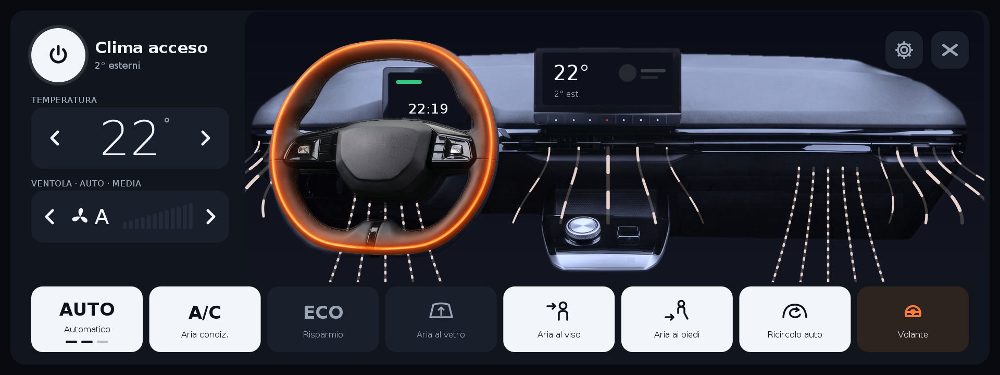
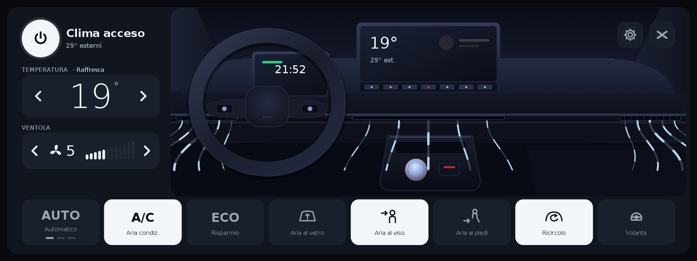

# MG4 Clima — HVAC

🇮🇹 [Italiano](#italiano) · 🇬🇧 [English](#english)

[](https://www.paypal.com/pool/9tv7fQ36nA?sr=wccr) [](https://www.paypal.com/pool/9tv7fQ36nA?sr=wccr)

Se ti è utile e ti va di contribuire alle ore passate a svilupparlo e provarlo in auto, puoi lasciare un'offerta: è del tutto **volontaria** e **non c'è un importo minimo**. Anche una stella al repository o una segnalazione sono un aiuto prezioso. Grazie!

> Progetto amatoriale e **non ufficiale**: non è affiliato né approvato da MG Motor o SAIC Motor.

> I nomi MG / MG4 servono solo a indicare l'auto compatibile. Installalo e usalo a tuo rischio.

> Hobby project, **not official**: not affiliated with or endorsed by MG Motor or SAIC Motor.

> The MG / MG4 names only identify the compatible car. Install and use it at your own risk.

## ⚠️ ATTENZIONE · WARNING ⚠️

> [!CAUTION]
> # 🚨 USI QUESTA APP A TUO RISCHIO E PERICOLO
> **MG4 Clima è un progetto amatoriale e sperimentale.** Comanda il climatizzatore della tua auto e lavora accanto
> ai servizi di sistema dell'infotainment. Un errore o un firmware diverso possono causare **malfunzionamenti
> dell'infotainment**.
>
> - **Non è un'app ufficiale** e non è approvata da MG Motor o SAIC Motor.
> - Può far **decadere la garanzia** sull'infotainment.
> - Installala e usala **solo ad auto ferma** e solo se sai come toglierla per tornare indietro
>   (Impostazioni Android › App › MG4 Clima › Disinstalla, oppure `adb uninstall com.mg4.clima`).
> - **Nessuna garanzia** e **nessuna responsabilità** dell'autore per qualsiasi danno, guasto, costo o problema
>   all'auto, all'infotainment o a persone.
>
> **Installando l'app dichiari di aver letto e accettato tutto questo.**

> [!CAUTION]
> # 🚨 USE THIS APP ENTIRELY AT YOUR OWN RISK
> **MG4 Clima is an experimental hobby project.** It controls your car's climate and works alongside the
> infotainment's system services. A mistake or a different firmware can cause **infotainment malfunctions**
> (top bar, dock, panels, climate).
>
> - **Not an official app**, not endorsed by MG Motor or SAIC Motor.
> - It may **void the infotainment warranty**.
> - Install and use it **only with the car stopped** and only if you know how to remove it to go back
>   (Android Settings › Apps › MG4 Clima › Uninstall, or `adb uninstall com.mg4.clima`).
> - **No warranty** and **no liability** of the author for any damage, fault, cost or problem to the car,
>   the infotainment or people.
>
> **By installing the app you declare that you have read and accepted all of this.**

## Download

| Software dell'auto / Car software | Auto / Car | Versione / Version | Stato / Status | Download |
|---|---|---|---|---|
| **MG4-Clima** | MG4 MY22 · MY23 · MY24 · Luxury MY24 | **1.2.0** | ⚠️ Sperimentale, a tuo rischio / Experimental, at your own risk | [⬇️ MG4Clima-1.2.0.apk](releases/MG4Clima-1.2.0.apk) |

**Un unico APK per tutti i modelli**: il software dell'auto si riconosce da solo. Dalla 1.0.0 gli aggiornamenti si

installano anche da **Impostazioni → Aggiornamenti**. · **One APK for every model**: the car software is detected

by itself. From 1.0.0 updates can also be installed from **Settings → Updates**.

Le versioni precedenti (una per modello) restano nella cartella [`releases/`](releases/). · Older versions (one per

model) are still in the [`releases/`](releases/) folder.

**Come sapere quale software hai / How to check your software:**

`adb shell getprop ro.build.mt2712.version` → `SWI68-…`, `SWI69-…`, `SWI132-…` o/or `SWI133-…`.

---


*Cruscotto **disegnato**: AUTO media, l'aria esce dalle bocchette vere ed è arancione perché riscalda, volante riscaldato ·

**Drawn** dashboard: AUTO medium, the air comes out of the real vents and is orange because it is heating, heated wheel (mock-up).*



*Cruscotto **realistico** (foto di una MG4, ripulita): stessa schermata, da scegliere nelle impostazioni ·

**Realistic** dashboard (photo of an MG4, cleaned up): same screen, chosen in the settings (mock-up).*



*Raffresca: 19° impostati con 29° fuori, l'aria diventa azzurra · Cooling: 19° set with 29° outside, the air turns blue (mock-up).*


*Tasti Parabrezza e Lunotto attivati nelle impostazioni, aria anche al vetro · Windscreen and Rear window buttons turned on in the settings, air to the windscreen too (mock-up).*


*Cruscotto realistico con il volante riscaldato, aria che esce dalle bocchette · Realistic dashboard with the heated wheel, air coming out of the vents (mock-up).*


*Guida a destra: comandi e cruscotto dal lato del guidatore · Right-hand drive: controls and dashboard on the driver's side (mock-up).*


*SWI69 / SWI132: senza sedili e volante riscaldati, temperatura 16–30 °C · SWI69 / SWI132: no heated seats or wheel, 16–30 °C (mock-up).*


*Auto spenta: la schermata resta in lettura · Car off: the screen only shows the state (mock-up).*

---

## Italiano

### Cos'è e cosa stò facendo

**MG4 Clima** è una nuova schermata del climatizzatore in stile Tesla per l'infotainment della MG4. Sostituisce l'app

clima originale senza modificarla:

- al centro c'è il **cruscotto della MG4 stilizzato**: volante, quadro strumenti, schermo centrale, console con la

  manopola e le **quattro bocchette**. Si vede **dove è indirizzata l'aria**:

  viso, piedi, parabrezza, con flussi più lunghi quando la ventola gira più forte e colore caldo quando la temperatura è alta;

- **accensione, temperatura e ventola sono dal lato del guidatore** (si specchia tutto con la guida a destra);

- in basso i tasti: **AUTO, A/C, ECO, direzione dell'aria, ricircolo, parabrezza, lunotto, volante e sedili** (sedili

  e volante solo dove ci sono);

- i colori sono quelli del **MG4 Launcher**.

MG4 Clima legge e comanda il clima con **gli stessi servizi dell'auto usati dall'app originale**, con gli stessi comandi

(premere un tasto di MG4 Clima è come premere quello dell'app originale). Quando l'app clima originale si apre, MG4 Clima

compare al suo posto. L'app originale non viene toccata: si può sempre riaprire dalle impostazioni, e se MG4 Clima viene

disinstallata tutto torna come prima.

### Funzioni

- **Comandi completi**: accensione, temperatura un grado alla volta fino a LO e HI, ventola (da AUTO riparte dall'ultima

  velocità), AUTO, A/C, ECO, ricircolo (interno → esterno → automatico), direzioni combinabili come nell'originale,

  sedili a 3 livelli e volante (SWI68).

- **Menù a tendina**: il sistema lo apre ogni volta che il clima si accende o si spegne. Con MG4 Clima in programmazione;

  dal tasto fisico, fuori da MG4 Clima, si richiude subito. Si può disattivare.

- **Apertura dal launcher**: con le prossime versioni di MG4 Launcher il tasto del clima apre direttamente MG4 Clima,

  senza far vedere per un istante l'app originale.

- **Impostazioni con la grafica del launcher**, a pagina intera: Schermata (lato di guida, cruscotto, aria animata,

  tasti, lingua), Clima automatico, Apertura del clima, Versione e aggiornamenti, Auto e Strumenti.

- **Un'unica app per tutti i modelli** (dalla 1.0.0): riconosce da sola SWI68, SWI69, SWI132 e SWI133 (dal software

  dell'auto o dalle app di sistema); se serve il modello si può scegliere a mano.

- **Aggiornamenti dalle impostazioni** (dalla 1.0.0), come MG4 Launcher: controlla, scarica, verifica e installa.

- **Pannello clima di sistema** (SWI68 e SWI133): quando l'auto lo apre all'accensione del clima o col tasto fisico,
  MG4 Clima lo richiude subito.

- **Test automatico dei comandi** (solo ad auto ferma): prova un comando alla volta, controlla che l'auto risponda,

  rimette tutto com'era e invia il log. Si ferma da solo se l'auto si muove o se si esce dalla schermata.

### Sicurezza

- Sostituisce solo le versioni dell'app clima già analizzate; con una versione sconosciuta lascia l'originale.

- Anti-ciclo: se l'app originale si riapre più di 3 volte in 10 secondi, MG4 Clima si mette in pausa per 2 minuti.

- Nessun dato personale: le impostazioni restano nell'auto, i log diagnostici sono anonimi.

### Installazione

Scarica l'APK dalla tabella in alto. Poi scegli uno dei due metodi.

#### Metodo 1 — Da chiavetta USB (senza computer)

Serve poter aprire un file manager sull'infotainment.

1. Copia `MG4Clima-1.2.0.apk` su una chiavetta USB formattata **FAT32** o **exFAT**.
2. Inserisci la chiavetta nell'auto, apri il file manager e tocca l'APK.
3. Se Android avvisa che non può installare app da questa fonte: tocca **Impostazioni**, attiva
   **Consenti da questa fonte** per il file manager e torna indietro.
4. Tocca **Installa**.
5. Apri il clima come al solito (tasto, barra o launcher): al primo avvio MG4 Clima si attiva da sola.

Se **Impostazioni** non apre nulla o l'installazione dà errore, usa il metodo 2
(e, se puoi, segnala il messaggio d'errore).

#### Metodo 2 — Con adb da computer

Serve un computer con [adb](https://developer.android.com/tools/releases/platform-tools) collegato all'auto.
Il firmware MG può bloccare l'installazione normale delle app: l'opzione `-f` la permette.

1. Installa:

   ```bash
   adb install -r -f MG4Clima-1.2.0.apk
   ```

2. Apri il clima come al solito (tasto, barra o launcher): al primo avvio MG4 Clima si attiva da sola.

Gli aggiornamenti successivi si installano anche da **Impostazioni → Aggiornamenti** dentro MG4 Clima.

**Per toglierla:** Impostazioni Android › App › MG4 Clima › **Disinstalla**, oppure `adb uninstall com.mg4.clima`.
L'app clima originale torna subito quella di sempre.

### Log e segnalazioni

MG4 Clima invia in forma anonima un log diagnostico quando si esce dalla schermata, alla fine del test automatico e con

**Impostazioni → Invia la diagnostica**: servono a capire come risponde ogni auto. In **Impostazioni → Diagnostica** ci

sono lo stato letto dall'auto e gli ultimi eventi: uno screenshot basta per segnalare un problema.

### Sostieni il progetto

MG4 Clima è e resterà **gratuito**. Se ti è utile e ti va di contribuire alle ore passate a svilupparlo e provarlo in

auto, puoi lasciare un'offerta: è del tutto **volontaria** e **non c'è un importo minimo**. Anche una stella al repository

o una segnalazione sono un aiuto prezioso. Grazie!

[](https://www.paypal.com/pool/9tv7fQ36nA?sr=wccr)

### Versioni

#### 1.2.0
- **Due cruscotti da scegliere** (Impostazioni › Schermata › Cruscotto): **Disegnato**, nuovo e più fedele alla MG4, e
  **Realistico**, da una foto di una MG4 ripulita. Sugli schermi solo le indicazioni di MG4 Clima.
- **L'aria esce dalle bocchette vere** e passa **dietro al volante**. Il colore dice cosa sta facendo il clima e
  cambia gradualmente con la temperatura impostata: **blu** verso i 16°, **neutro** intorno ai 21°, **arancione** dai 26° in su.
- **Tema giorno e notte**, con i colori del launcher: chiaro di giorno, blu di notte.
- **Volante riscaldato**: la corona si accende con una linea arancione luminosa lungo il bordo.
- **AUTO**: con AUTO acceso, toccarlo cambia l'intensità **Bassa → Media → Alta**; i trattini sotto il tasto la mostrano
  e la ventola scrive "AUTO · Media". Si esce da AUTO toccando la ventola, come nell'app originale.
- **Impostazioni del clima originale** (SWI68, SWI133 e SWI69): intensità di AUTO, **segui la modalità di guida ECO**
  e **lunotto riscaldato automatico** (non sulla SWI69), lette e scritte nell'auto.
- **Tasti Parabrezza e Lunotto** nascosti di default (l'auto ha i tasti fisici): si attivano nelle impostazioni.
- **Multilingua come il launcher**: italiano, inglese, spagnolo, tedesco, portoghese, francese, turco e polacco. Segue la
  lingua dell'auto oppure si sceglie in Impostazioni › Schermata › Lingua.
- **Versione nelle impostazioni** (Versione e aggiornamenti), non più nella schermata.

#### 1.1.0
- **Pannello clima di sistema riconosciuto appena compare** (SWI68 e SWI133): MG4 Clima vede la finestra del pannello
  nel momento in cui si apre e la chiude subito con il comando del sistema.
- **Nuova scelta nelle impostazioni**: chiudere il pannello **sempre**, **solo con MG4 Clima aperto** oppure
  **lasciarlo**. Di default resta come prima (sempre).
- **Aria animata**: l'aria scorre dalle bocchette verso il viso, i piedi e ora anche il **parabrezza**; più veloce e fitta
  con la ventola alta, colore che passa gradualmente dal freddo al caldo con la temperatura. Si spegne nelle
  impostazioni (Schermata › Aria animata).

#### 1.0.2
- **Tasto per chiudere la schermata** in alto, accanto alle impostazioni.
- **Pannello clima di sistema chiuso più in fretta**: MG4 Clima riceve l'avviso di accensione del clima nello stesso
  istante del sistema (anche dal launcher o dal tasto fisico) e lo richiude subito, più volte nel primo secondo.
- Tolta dalle impostazioni la voce per installare l'integrazione col pannello clima: il sistema dell'auto non la
  accetta.

#### 1.0.1
- Integrazione col pannello clima di sistema: prima di scaricare controlla l'accesso e, se non riesce, dice il
  motivo esatto (connessione, accesso negato) e invia il log.

#### 1.0.0 — app unica (sperimentale)

- Un'unica app per SWI68, SWI69, SWI132 e SWI133: il modello si riconosce da solo (o si sceglie nelle impostazioni).

- Aggiornamenti dalle impostazioni, come MG4 Launcher.

- Integrazione facoltativa col pannello clima di sistema (SWI68 e SWI133): MG4 Clima ne prende il posto, anche dal

  tasto fisico del clima.

- Pannello clima di sistema richiuso subito anche quando si apre col tasto fisico.

- Impostazioni riscritte: Schermata, Apertura del clima, Pannello clima di sistema, Aggiornamenti, Auto, Strumenti.

#### SWI68 0.3.2-beta

- Comandi veri dalla schermata (verificati sull'auto con il test automatico).

- Bocchette come la MG4: laterale guidatore, due centrali, laterale passeggero.

- Impostazioni e conferme con la grafica del launcher.

- Test automatico: HI raggiunto un grado alla volta, AUTO come l'originale, direzione dell'aria rimessa com'era.

- Indicazione della direzione dell'aria automatica.

#### SWI68 0.2.0-beta

- Test automatico dei comandi e invio dei log.

- Registro dei cambi fatti dall'app originale o dai tasti fisici.

#### SWI68 0.1.0-beta — prima versione

- Schermata in sola lettura: stato reale del clima, tocchi che aprono l'app originale.

#### SWI69 / SWI132 0.1.0-beta — prima versione

- Stessa schermata, impostazioni e test automatico della SWI68, con il servizio clima di SWI69 e SWI132.

- Temperatura 16–30 °C con LO e HI; sedili e volante riscaldati nascosti.

#### SWI133 0.1.0-beta — prima versione

- Stessa schermata, comandi, impostazioni e test automatico della SWI68 (stesso servizio clima, codici verificati sul

  firmware della 133).

- Si apre dal launcher o dall'elenco app; il pannello clima originale resta disponibile dalle impostazioni.

### Compilare

Dalla 1.0.0 c'è un'unica app nella cartella `MG4Clima` con `build.sh`; strumenti e chiave in `tools/` e `keys/`.

Servono JDK 17+, `tools/android.jar` (API 28) e `tools/d8.jar` (non inclusi):

```bash

cd MG4Clima && ./build.sh      # → build/MG4Clima-<versione>.apk

```

L'APK è firmato con la chiave di piattaforma di test AOSP (come il firmware MG), necessaria per i permessi di sistema.

---

## English

### What it is and what we're doing

**MG4 Clima** is a new Tesla-style climate screen for the MG4 infotainment. It replaces the original climate app without

modifying it:

- in the middle there is a **stylised MG4 dashboard**: steering wheel, instrument cluster, central screen, console

  with the rotary knob and the **four vents**. You can see **where the air is directed**:

  face, feet, windscreen, with longer flows at higher fan speeds and a warm colour at high temperatures;

- **power, temperature and fan are on the driver's side** (everything is mirrored for right-hand drive);

- the buttons at the bottom: **AUTO, A/C, ECO, air direction, recirculation, windscreen, rear window, wheel and seats**

  (seats and wheel only where the car has them);

- the colours are those of **MG4 Launcher**.

MG4 Clima reads and controls the climate through **the same car services used by the original app**, with the same

commands (pressing a button in MG4 Clima is like pressing it in the original app). When the original climate app opens,

MG4 Clima appears instead. The original app is never modified: it can always be opened from the settings, and if MG4

Clima is uninstalled everything goes back to how it was.

### Features

- **Full controls**: power, temperature one degree at a time up to LO and HI, fan (from AUTO it restarts from the last

  speed), AUTO, A/C, ECO, recirculation (inside → outside → automatic), combinable directions like the original,

  3-level seats and wheel (SWI68).

- **Pull-down menu**: the system opens it every time the climate turns on or off. With MG4 Clima open it doesn't come

  down; from the physical button, outside MG4 Clima, it closes straight away. It can be switched off.

- **Opening from the launcher**: with the next MG4 Launcher versions the climate button opens MG4 Clima directly,

  without briefly showing the original app.

- **Settings with the launcher's look**, full page: Screen (driving side, dashboard, animated air, buttons,

  language), Automatic climate, Opening the climate, Version and updates, Car and Tools.

- **One app for every model** (from 1.0.0): it detects SWI68, SWI69, SWI132 and SWI133 by itself (from the car software

  or the system apps); the model can also be chosen by hand.

- **Updates from the settings** (from 1.0.0), like MG4 Launcher: check, download, verify and install.

- **System climate panel** (SWI68 and SWI133): when the car opens it as the climate turns on or from the physical
  button, MG4 Clima closes it straight away.

- **Automatic command test** (car stopped only): tries one command at a time, checks that the car responds, restores

  everything and sends the log. It stops by itself if the car moves or you leave the screen.

### Safety

- It only replaces the climate app versions that have been analysed; with an unknown version it leaves the original.

- Anti-loop: if the original app reopens more than 3 times in 10 seconds, MG4 Clima pauses for 2 minutes.

- No personal data: settings stay in the car, diagnostic logs are anonymous.

### Installation

Download the APK from the table at the top. Then pick one of the two methods.

#### Method 1 — From a USB stick (no computer)

You need to be able to open a file manager on the infotainment.

1. Copy `MG4Clima-1.2.0.apk` to a USB stick formatted as **FAT32** or **exFAT**.
2. Plug it into the car, open the file manager and tap the APK.
3. If Android says it cannot install apps from this source: tap **Settings**, enable
   **Allow from this source** for the file manager and go back.
4. Tap **Install**.
5. Open the climate as usual (button, bar or launcher): MG4 Clima activates itself on first start.

If **Settings** does nothing or the install fails, use method 2 (and, if you can, report the error message).

#### Method 2 — With adb from a computer

You need a computer with [adb](https://developer.android.com/tools/releases/platform-tools) connected to the car.
The MG firmware may block normal app installs; the `-f` option allows it.

1. Install it:

   ```bash
   adb install -r -f MG4Clima-1.2.0.apk
   ```

2. Open the climate as usual (button, bar or launcher): MG4 Clima activates itself on first start.

Later updates can also be installed from **Settings → Updates** inside MG4 Clima.

**To remove it:** Android Settings › Apps › MG4 Clima › **Uninstall**, or `adb uninstall com.mg4.clima`.
The original climate app is back straight away.

### Logs and reports

MG4 Clima sends an anonymous diagnostic log when you leave the screen, at the end of the automatic test and with

**Settings → Send diagnostics**: they help to understand how each car responds. **Settings → Diagnostics** shows the

state read from the car and the latest events: a screenshot is enough to report a problem.

### Support the project

MG4 Clima is and will stay **free**. If you find it useful and would like to contribute to the hours spent developing

and testing it in the car, you can leave a donation: it is completely **voluntary** and there is **no minimum amount**.

A star on the repository or a bug report also help a lot. Thank you!


[](https://www.paypal.com/pool/9tv7fQ36nA?sr=wccr)


### Changelog

#### 1.2.0
- **Two dashboards to choose from** (Settings › Screen › Dashboard): **Drawn**, new and closer to the MG4, and
  **Realistic**, from a cleaned-up photo of an MG4. The screens only show MG4 Clima's information.
- **The air comes out of the real vents** and passes **behind the steering wheel**. The colour shows what the climate is
  doing and changes gradually with the set temperature: **blue** towards 16°, **neutral** around 21°, **orange** from 26° up.
- **Day and night themes**, with the launcher's colours: light by day, blue at night.
- **Heated steering wheel**: the rim lights up with a glowing orange line along its edge.
- **AUTO**: with AUTO on, tapping it changes the intensity **Low → Medium → High**; the dashes under the button show it
  and the fan reads "AUTO · Medium". Leave AUTO by touching the fan, as in the original app.
- **Original climate app settings** (SWI68, SWI133 and SWI69): AUTO intensity, **follow ECO drive mode** and **automatic
  rear window heating** (not on SWI69), read from and written to the car.
- **Windscreen and Rear window buttons** hidden by default (the car has physical buttons): they can be turned on in the
  settings.
- **Multilingual like the launcher**: Italian, English, Spanish, German, Portuguese, French, Turkish and Polish. It
  follows the car's language or can be chosen in Settings › Screen › Language.
- **Version in the settings** (Version and updates), no longer on the screen.

#### 1.1.0
- **System climate panel recognised as soon as it appears** (SWI68 and SWI133): MG4 Clima sees the panel window the
  moment it opens and closes it straight away with the system's own command.
- **New choice in the settings**: close the panel **always**, **only with MG4 Clima open** or **leave it**. By default
  it works as before (always).
- **Animated air**: the air flows out of the vents towards the face, the feet and now also the **windscreen**; faster
  and denser with a higher fan speed, colour fading gradually from cold to warm with the temperature. It can be turned
  off in the settings (Screen › Animated air).

#### 1.0.2
- **Button to close the screen** at the top, next to the settings.
- **System climate panel closed faster**: MG4 Clima gets the climate-on notice at the same moment as the system
  (also from the launcher or the physical button) and closes it straight away, several times in the first second.
- Removed from the settings the entry to install the system climate panel integration: the car's system doesn't
  accept it.

#### 1.0.1
- System climate panel integration: before downloading it checks access and, if it fails, tells the exact reason
  (connection, access denied) and sends the log.

#### 1.0.0 — one app (experimental)

- One app for SWI68, SWI69, SWI132 and SWI133: the model is detected by itself (or chosen in the settings).

- Updates from the settings, like MG4 Launcher.

- Optional integration with the system climate panel (SWI68 and SWI133): MG4 Clima takes its place, also from the

  physical climate button.

- System climate panel closed at once, also when opened with the physical button.

- Settings rewritten: Screen, Opening the climate, System climate panel, Updates, Car, Tools.

#### SWI68 0.3.2-beta

- Real commands from the screen (verified on the car with the automatic test).

- System pull-down menu blocked while MG4 Clima is open, closed at once from the physical button.

- Vents like the MG4: driver side, two central, passenger side.

- Settings and confirmations with the launcher's look.

- Automatic test: HI reached one degree at a time, AUTO like the original, air direction restored.

- Automatic air direction shown.

#### SWI68 0.2.0-beta

- Automatic command test and log sending.

- Log of the changes made from the original app or the physical buttons.

#### SWI68 0.1.0-beta — first version

- Read-only screen: real climate state, taps open the original app.

#### SWI69 / SWI132 0.1.0-beta — first version

- Same screen, settings and automatic test as SWI68, with the SWI69 and SWI132 climate service.

- Temperature 16–30 °C with LO and HI; heated seats and wheel hidden.

#### SWI133 0.1.0-beta — first version

- Same screen, commands, settings and automatic test as SWI68 (same climate service, codes checked on the 133 firmware).

- Opens from the launcher or the app list; the original climate panel is still available from the settings.

### Building

From 1.0.0 there is one app in the `MG4Clima` folder with `build.sh`; tools and key in `tools/` and `keys/`.

You need JDK 17+, `tools/android.jar` (API 28) and `tools/d8.jar` (not included):

```bash

cd MG4Clima && ./build.sh      # → build/MG4Clima-<version>.apk

```
The APK is signed with the AOSP test platform key (like the MG firmware), required for the system permissions.
