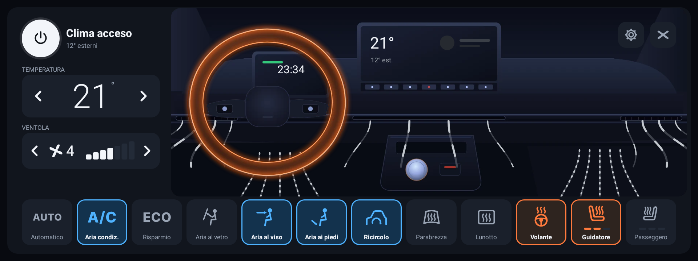
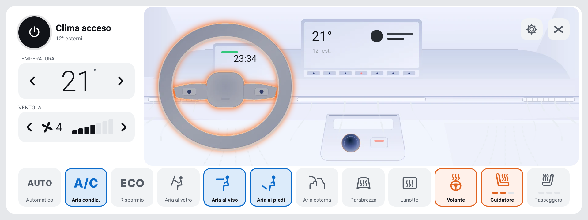
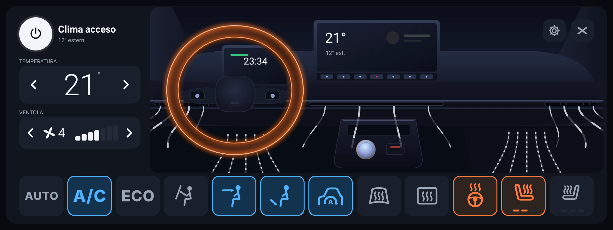
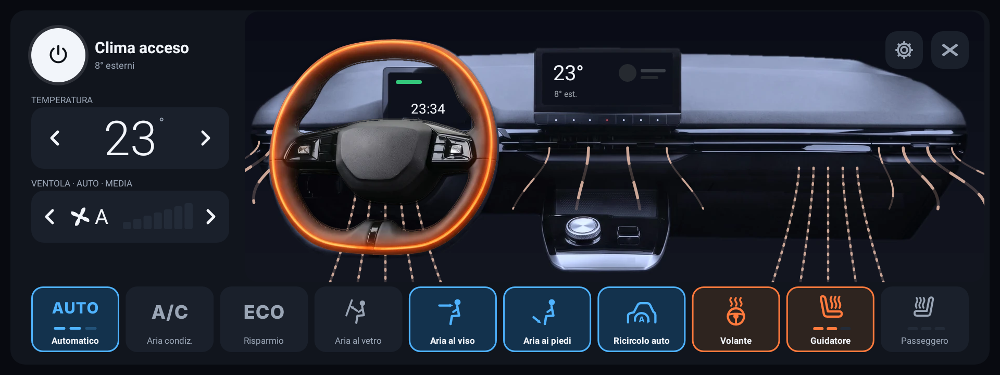
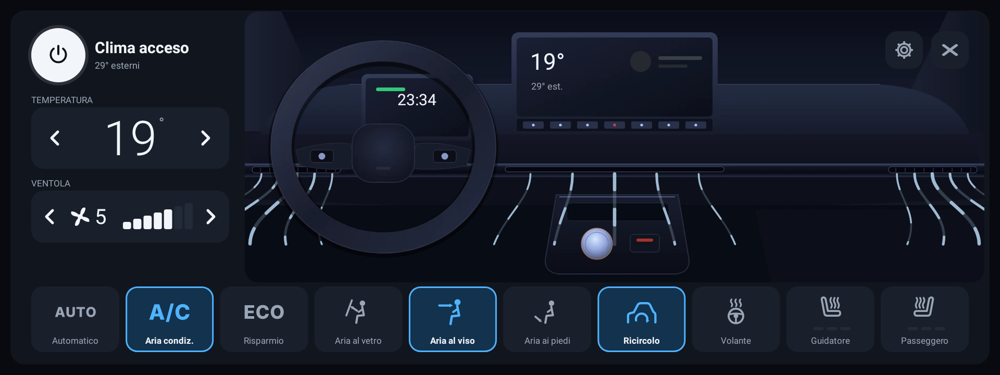
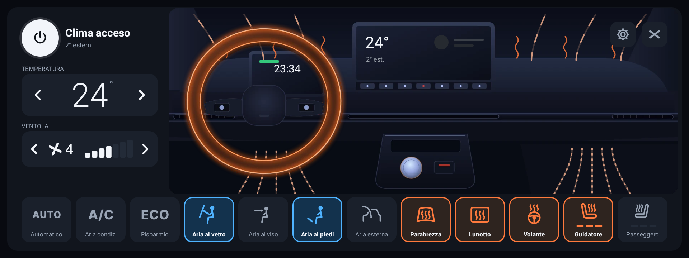
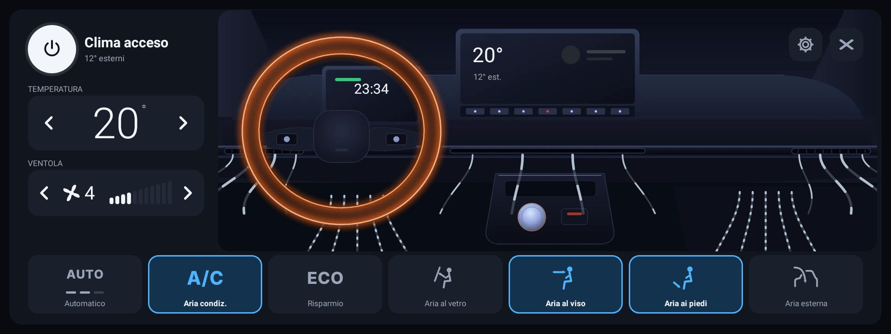
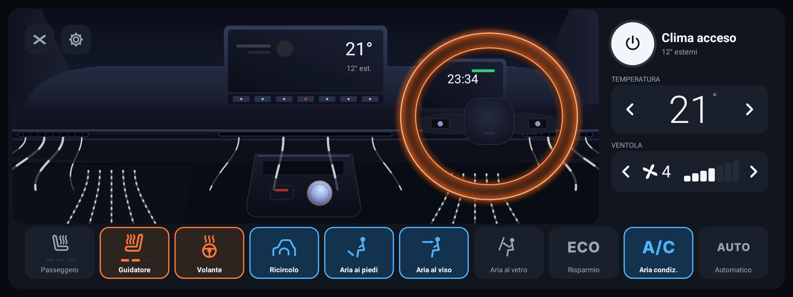
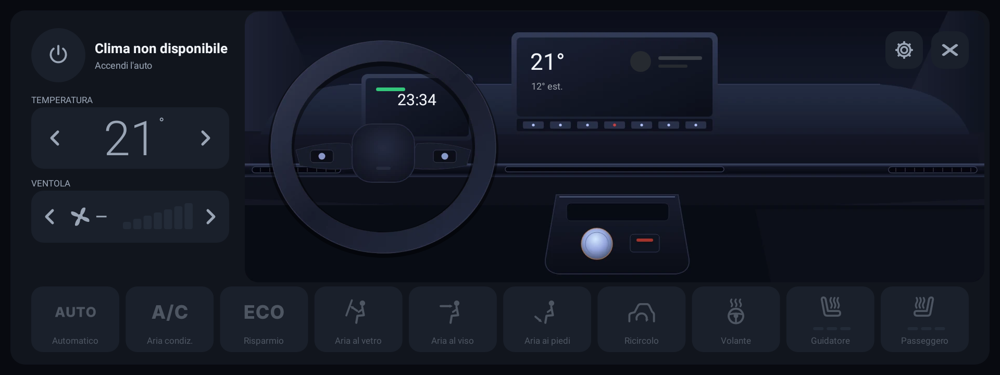

# MG4 Clima — HVAC

<p align="center"></p>

<p align="center">
<b>Schermata del clima in stile Tesla per l'infotainment MG4: SWI68, SWI69, SWI132 e SWI133</b><br>
<i>Tesla-style climate screen for the MG4 infotainment: SWI68, SWI69, SWI132 and SWI133</i>
</p>

<p align="center">
<a href="releases/MG4Clima-1.4.2.apk"></a>
<a href="https://paypal.me/ErnestoMicco?locale.x=it_IT&country.x=IT"></a>
</p>

<p align="center">
🇮🇹 <a href="#italiano">Italiano</a> · 🇬🇧 <a href="#english">English</a> ·
<a href="#quale-versione-installare--which-version-should-i-install">Quale versione? / Which version?</a> ·
<a href="#versioni">Novità</a> / <a href="#changelog">What's new</a>
</p>

> ⚠️ **Compatibilità / Compatibility:** **un unico APK** per **SWI68 SAIC 1.0+**, **SWI69 Color Radio**, **SWI132** e
> **SWI133**: il software dell'auto si riconosce da solo · **one APK** for **SWI68 SAIC 1.0+**, **SWI69 Color Radio**,
> **SWI132** and **SWI133**: the car software is detected by itself.
> Provato su **MG4 Luxury MY22 R69**; sugli altri software funziona grazie ai log degli utenti ·
> tested on **MG4 Luxury MY22 R69**; on the other software it works thanks to the users' logs.

> [!CAUTION]
> **Progetto amatoriale, sperimentale e non ufficiale**: non è affiliato né approvato da MG Motor o SAIC Motor. Comanda
> il climatizzatore e lavora accanto ai servizi di sistema dell'infotainment: installalo e usalo **a tuo rischio**, solo
> ad auto ferma e se sai come toglierlo. Può far decadere la garanzia dell'infotainment; nessuna responsabilità
> dell'autore per danni o problemi. I nomi MG / MG4 servono solo a indicare l'auto compatibile.
>
> **Hobby project, experimental and not official**: not affiliated with or endorsed by MG Motor or SAIC Motor. It
> controls the climate and works alongside the infotainment's system services: install and use it **at your own risk**,
> only with the car stopped and if you know how to remove it. It may void the infotainment warranty; no liability of the
> author for damage or problems. The MG / MG4 names only identify the compatible car.

---

## Schermate / Screenshots

<table>
<tr>
<td width="50%" valign="top"><br>
<sub>Tema <b>giorno</b> con le scritte (qui aria esterna) · <i><b>Day</b> theme with labels (here fresh air)</i></sub></td>
<td width="50%" valign="top"><br>
<sub><b>Solo icone</b>, più grandi, come nella home del launcher (qui ricircolo automatico) · <i><b>Icons only</b>, larger, like the launcher home (here automatic recirculation)</i></sub></td>
</tr>
<tr>
<td width="50%" valign="top"><br>
<sub>Cruscotto <b>realistico</b> (foto di una MG4): AUTO media, l'aria arancione riscalda · <i><b>Realistic</b> dashboard (photo of an MG4): AUTO medium, orange air is heating</i></sub></td>
<td width="50%" valign="top"><br>
<sub><b>Raffresca</b>: 19° impostati con 29° fuori, l'aria diventa azzurra · <i><b>Cooling</b>: 19° set with 29° outside, the air turns blue</i></sub></td>
</tr>
<tr>
<td width="50%" valign="top"><br>
<sub><b>Inverno</b>: parabrezza, lunotto, sedile e volante riscaldati · <i><b>Winter</b>: windscreen, rear window, heated seat and wheel</i></sub></td>
<td width="50%" valign="top"><br>
<sub><b>SWI69 / SWI132</b>: senza sedili e volante riscaldati · <i><b>SWI69 / SWI132</b>: no heated seats or wheel</i></sub></td>
</tr>
<tr>
<td width="50%" valign="top"><br>
<sub><b>Guida a destra</b>: comandi e cruscotto dal lato del guidatore · <i><b>Right-hand drive</b>: controls and dashboard on the driver's side</i></sub></td>
<td width="50%" valign="top"><br>
<sub><b>Auto spenta</b>: la schermata mostra solo lo stato · <i><b>Car off</b>: the screen only shows the state</i></sub></td>
</tr>
</table>

<sub>Simulazioni della grafica: i valori sono di esempio · Design mock-ups: values are examples.</sub>

> 🏠 **Con [MG4 Launcher](https://github.com/ernestomicco2026-cell/Mg4-Launcher-SWI68)** il tasto del clima della home apre direttamente MG4 Clima.
>
> 🏠 **With [MG4 Launcher](https://github.com/ernestomicco2026-cell/Mg4-Launcher-SWI68)** the home's climate button opens MG4 Clima directly.

---

## Quale versione installare? / Which version should I install?

C'è **un solo APK per tutte le MG4**: MG4 Clima riconosce da sola il software dell'auto (dal nome del software o dalle
app di sistema). Se serve, il modello si può scegliere a mano nelle impostazioni.

| Software dell'auto | Auto | Clima originale | Note |
|---|---|---|---|
| **SWI68 SAIC 1.0+** (anche SWI165, SWI167, DBI68) | MG4 | app clima + pannello di sistema | sedili e volante riscaldati, temperatura 17–33 (LO/HI) |
| **SWI69 Color Radio** (anche SWI131) | MG4 MY23 | app clima | temperatura 16–30 (LO/HI) |
| **SWI132** | MG4 MY24 | app clima | come la SWI69 |
| **SWI133** | MG4 Luxury MY24 | pannello di sistema | si apre dal launcher o dall'elenco app |

File: `MG4Clima-X.Y.Z.apk` nella cartella [`releases/`](releases/), dove restano anche le versioni precedenti.

**Come sapere quale software hai:** con il computer collegato all'auto
`adb shell getprop ro.build.mt2712.version` → l'inizio dice il software: `SWI68-…`, `SWI69-…`, `SWI132-…` o `SWI133-…`.
In MG4 Clima: **Impostazioni**, il modello è scritto sotto il titolo.

There is **one APK for every MG4**: MG4 Clima detects the car software by itself (from the software name or the system
apps); if needed the model can be chosen by hand in the settings. Check your software with
`adb shell getprop ro.build.mt2712.version` (it starts with `SWI68-`, `SWI69-`, `SWI132-` or `SWI133-`).

---

## Video recensione / Video review

<a href="https://www.youtube.com/watch?v=AvaCQh5QNcQ"></a>

**[E il climatizzatore diventa in stile Tesla](https://www.youtube.com/watch?v=AvaCQh5QNcQ)**, la recensione di Ciro "Kankunen" Cunato su YouTube (in italiano). Grazie! ·
MG4 Clima review by Ciro "Kankunen" Cunato on YouTube (in Italian). Thank you!

---

## Italiano

Schermata del climatizzatore in stile Tesla per l'infotainment della **MG4** (EH32, Android Automotive 9), un'unica app
per **SWI68, SWI69, SWI132 e SWI133**. Si apre al posto dell'app clima originale, che **non viene modificata**: se
MG4 Clima viene tolta o va in crash, il clima originale funziona come sempre. Comanda il clima con gli stessi servizi
dell'auto e gli stessi comandi dell'app originale: premere un tasto di MG4 Clima è come premere quello originale.

**Indice:** [Cosa fa](#cosa-fa) · [Joystick del volante](#joystick-del-volante) · [Verifica dell'app clima originale](#verifica-dellapp-clima-originale) · [Installazione](#installazione) · [Aggiornamenti](#aggiornamenti) · [Tornare al clima originale](#tornare-al-clima-originale) · [Comandi utili](#comandi-utili) · [Segnalare un problema](#segnalare-un-problema) · [Sostieni il progetto](#sostieni-il-progetto) · [Versioni](#versioni)

### Cosa fa

- **Cruscotto della MG4 stilizzato** al centro: volante, quadro strumenti, schermo centrale, console e le **quattro
  bocchette**. Si vede **dove va l'aria** (viso, piedi, parabrezza), con flussi più lunghi quando la ventola gira più
  forte, **arancione** quando riscalda e **azzurra** quando raffresca. Cruscotto **disegnato** o **realistico** (foto di
  una MG4), da scegliere nelle impostazioni.
- **Dal lato del guidatore**: accensione, temperatura un grado alla volta fino a **LO** e **HI**, ventola (OFF / 1…11 /
  A = automatica; da AUTO riparte dall'ultima velocità; come nell'originale, "ventola −" alla velocità minima spegne il
  clima e "ventola +" a clima spento lo riaccende). Con la guida a destra la schermata si specchia.
- **Pulsanti in basso**, con le **icone dei tasti fisici dell'auto** (stile ISO): AUTO (con l'intensità bassa / media /
  alta), A/C, ECO, aria al vetro / al viso / ai piedi (combinabili come nell'originale), **ricircolo** (un'icona per stato:
  interno, aria esterna, automatico), parabrezza e lunotto (facoltativi: l'auto ha già i tasti), volante e sedili
  riscaldati a 3 livelli (solo dove ci sono).
- **Stato a colpo d'occhio**: un pulsante acceso ha l'icona più grande, il **colore acceso**, lo sfondo evidenziato e il
  bordo; i riscaldamenti sono in **arancio**; con l'auto spenta i pulsanti sono attenuati. Con **Mostra le scritte sui
  pulsanti** spento restano solo icone più grandi, come nella home del launcher.
- **Joystick del volante**: con MG4 Clima aperta il joystick destro comanda solo il clima (vedi sotto).
- **Apertura rapida**: quando l'app clima originale si apre, una schermata già pronta la copre subito mentre MG4 Clima si
  apre. Con MG4 Launcher il tasto del clima apre direttamente MG4 Clima.
- **Clima durante Android Auto e CarPlay** (opzione, spenta di default): con la proiezione davanti, un tocco al centro
  della barra in alto apre MG4 Clima (durante la proiezione il sistema non apre il suo clima).
- **Pannello clima di sistema** (SWI68 e SWI133): quando l'auto lo apre all'accensione del clima o col tasto fisico,
  MG4 Clima lo richiude subito (si può lasciare).
- **Chiusura** col tasto ✕, con uno swipe verticale (anche dal bordo alto o basso dello schermo), toccando fuori dal
  pannello o col tasto indietro.
- **Clima automatico**: intensità di AUTO e "segui ECO" dell'app originale, letti e scritti nell'auto (dove ci sono).
- **Impostazioni** a pagina intera, con la grafica del launcher: Schermata (lato di guida, cruscotto, aria animata,
  scritte sui pulsanti, tasti parabrezza/lunotto, lingua), Clima automatico, Apertura del clima (sostituzione, swipe,
  joystick, apertura rapida, pannello di sistema), Versione e aggiornamenti, Auto e Strumenti (verifica, test, prova tasti
  del volante, modalità officina, diagnostica).
- **Tema giorno e notte** come il launcher, che segue quello dell'auto.
- **Lingue**: italiano, inglese, spagnolo, tedesco, portoghese, francese, turco e polacco, automatica come l'auto o
  scelta nelle impostazioni. Dopo ogni aggiornamento un popup **Novità** dice cosa è cambiato.

### Joystick del volante

Con **MG4 Clima aperta**, il **joystick destro** del volante comanda il clima:

| Tasto | Cosa fa |
|---|---|
| **Su / Giù** | temperatura + / − (tenendo premuto si ripete) |
| **Sinistra / Destra** | ventola − / + (tenendo premuto si ripete) |
| **OK** | accende il clima in AUTO, oppure lo spegne |

Sulla schermata si illumina il pulsante comandato. È pronto subito: non serve associare niente.

**I tasti comandano solo il clima** (dalla 1.4.1). MG4 Clima prende il tasto **prima** che l'auto lo mandi alla musica,
con il suo servizio di accessibilità: volume e brano non cambiano mentre regoli il clima. È lo stesso metodo di
MG4 Control, provato in auto.

- I tasti si prendono **solo con MG4 Clima davanti**, e solo i 5 del joystick destro. Tutti gli altri tasti (telefono,
  voce, ★, tasti di sinistra e sotto lo schermo) funzionano sempre come prima.
- Appena esci da MG4 Clima, o se davanti va un'altra app, il joystick torna subito alla musica.
- Un tasto premuto con MG4 Clima aperta resta a MG4 Clima fino al rilascio, anche se intanto la chiudi.
- Se c'è un errore il tasto passa al sistema; se MG4 Clima va in crash il blocco sparisce con lei.
- Se su un'auto non si riesce a tenere i tasti, MG4 Clima se ne accorge da sola dopo qualche pressione. I comandi dal
  joystick restano attivi, ma nelle impostazioni c'è scritto che su quel software volume e brano possono cambiare
  insieme al clima.
- Se il joystick è nella **modalità clima dell'auto** (tasto ★ impostato su Clima nelle impostazioni del veicolo), il
  clima lo comanda già l'auto: MG4 Clima non manda comandi doppi e mostra solo lo stato.
- **Con un'altra app che usa il joystick** (per esempio MG4 Control): le impostazioni mostrano quale app è e consigliano
  di disattivare il joystick nell'altra app per usarlo con MG4 Clima.

Si accende e si spegne in **Impostazioni → Apertura del clima → Comandi dal joystick**. In **Strumenti → Prova tasti
del volante** si vedono i codici dei tasti e si può riassociare il joystick. Il joystick sinistro manda gli stessi
tasti del destro: si può controllare con **Prova**.

### Verifica dell'app clima originale

Ogni auto ha una sua versione dell'app clima originale (per esempio **HVAC.41131**). MG4 Clima la sostituisce solo
quando la versione è stata verificata; altrimenti lascia l'originale e il clima funziona come prima.

1. Ferma l'auto, con il freno di stazionamento, e spegni il clima.
2. Apri MG4 Clima: compare la richiesta di verifica. Oppure **Impostazioni → Strumenti → Verifica app clima**.
3. Conferma. La prova dura circa due minuti: accende e regola il clima, poi rimette tutto com'era.
4. Se riesce, da quel momento MG4 Clima sostituisce l'app originale. Se l'auto si muove la verifica si ferma e si può
   riprendere da dove era arrivata.

**LO** e **HI** sono quelli della tua auto: sulle SWI68, SWI133 e DBI68 MG4 Clima li legge dall'auto, e la verifica
controlla fin dove l'auto arriva davvero (il modello turco DBI68, per esempio, si ferma a 31). Sulle SWI69 e SWI132 il
servizio non li dice: la verifica prova i valori possibili e tiene quelli che l'auto rilegge correttamente. Se per LO o
HI non va nessun valore, si nasconde solo quello e la sostituzione resta possibile.

**Modalità officina** (Impostazioni → Strumenti): sospende la sostituzione per 1, 3 o 7 giorni, così in officina si vede
l'app originale. Alla scadenza torna tutto da solo.

### Installazione

Scarica l'APK dalla cartella [`releases/`](releases/), poi scegli uno dei due metodi.

**Metodo 1 — Da chiavetta USB (senza computer).** Serve poter aprire un file manager sull'infotainment.

1. Copia `MG4Clima-1.4.2.apk` su una chiavetta USB formattata **FAT32** o **exFAT**.
2. Inserisci la chiavetta, apri il file manager e tocca l'APK.
3. Se Android dice che non può installare app da questa fonte: tocca **Impostazioni**, attiva **Consenti da questa
   fonte** e torna indietro.
4. Tocca **Installa**.

**Metodo 2 — Con adb da computer.** Serve un computer con [adb](https://developer.android.com/tools/releases/platform-tools)
collegato all'auto. Il firmware MG può bloccare l'installazione normale delle app: l'opzione `-f` la permette.

```bash
adb install -r -f MG4Clima-1.4.2.apk
```

Poi apri il clima come al solito (tasto, barra o launcher): al primo avvio MG4 Clima si attiva da sola.

### Aggiornamenti

MG4 Clima **controlla da sola** se c'è una versione nuova: circa 2 minuti dopo l'accensione e poi ogni 6 ore. Se c'è,
all'apertura compare un avviso discreto con il pulsante **Aggiorna**. Si può controllare anche a mano da
**Impostazioni → Versione e aggiornamenti → Controlla**. Prima di installare, MG4 Clima controlla che il file sia quello
giusto (dimensione, impronta SHA-256 e firma). Si può aggiornare anche da computer, con lo stesso comando
dell'installazione.

Per problemi seri l'app può anche **aggiornarsi da sola** a una versione minima, solo ad auto ferma, e mostrare
**avvisi importanti** scritti nel repository (nella lingua dell'app, una volta sola o fino a quando premi OK).

### Tornare al clima originale

- **Per un attimo**: Impostazioni → Strumenti → **App clima originale** (la sostituzione resta sospesa per 2 minuti).
- **Sempre**: Impostazioni → Apertura del clima → spegni **MG4 Clima al posto dell'app originale**.
- **Togliere MG4 Clima**, anche senza computer: Impostazioni → Strumenti → **Disinstalla MG4 Clima**. Da computer:
  `adb uninstall com.mg4.clima`.
  L'app clima originale torna subito quella di sempre.

### Comandi utili

```bash
# riavviare MG4 Clima senza spegnere l'auto
adb shell am force-stop com.mg4.clima

# vedere gli eventi di MG4 Clima (Ctrl+C per fermare)
adb logcat -s MG4Clima

# scaricare la diagnostica salvata da MG4 Clima
adb pull /sdcard/Android/data/com.mg4.clima/files/diagnostica.txt
```

### Segnalare un problema

In **Impostazioni → Strumenti → Diagnostica** ci sono lo stato letto dall'auto, il software riconosciuto, la versione
dell'app clima originale e gli ultimi eventi: uno screenshot di quella pagina basta per capire cosa succede.

I log diagnostici vengono inviati in forma anonima quando si esce dalla schermata, alla fine del test o della verifica e
con **Strumenti → Invia la diagnostica**: servono a capire come risponde ogni auto. Nessun dato personale: le impostazioni restano
nell'auto.

### Sostieni il progetto

MG4 Clima è e resterà **gratuito**. Se ti è utile e ti va di contribuire alle ore passate a svilupparlo e provarlo
in auto, puoi lasciare un'offerta: è del tutto **volontaria** e **non c'è un importo minimo**, puoi donare quello che
vuoi. Anche una stella al repository o una segnalazione di un problema sono un aiuto prezioso. Grazie!

Anche solo **2 €** sono un aiuto prezioso per continuare a sviluppare e provare in auto le nuove versioni.

[](https://paypal.me/ErnestoMicco?locale.x=it_IT&country.x=IT)

### Versioni

#### 1.4.2
- **Temperatura con l'intervallo vero dell'auto.** Sulle SWI68, SWI133 e DBI68 minimo e massimo si leggono dall'auto (17 = LO e 33 = HI restano solo come riserva). La verifica sale un grado alla volta fino a dove l'auto arriva davvero e usa quel valore come HI: sul modello turco DBI68, che si ferma a 31, la verifica ora passa.
- **SWI69 e SWI132:** la verifica prova LO tra 17, 16, 15,5 e 15 e HI tra 30,5, 31, 32 e 33, e tiene quelli che l'auto rilegge correttamente. Un LO che torna come HI viene scartato. Funzionano sia le auto con 15,5 = LO e 30,5 = HI sia quelle con 17 = LO e 33 = HI. Se l'auto si ferma prima (variante 16–28) o la ventola arriva solo a 8, lo si vede nella diagnostica.
- **Joystick:** l'esclusiva dei tasti si rimisura su ogni auto. Il filtro conta solo con la schermata aperta, anche quando l'app in primo piano viene letta in ritardo. All'apertura si controlla che il filtro sia davvero acceso nel sistema. Se i tasti non si possono tenere, i comandi dal joystick restano attivi e le impostazioni spiegano che volume e brano possono cambiare insieme al clima.
- **Altre app con il joystick** (es. MG4 Control): le impostazioni dicono quale app è e cosa fare.
- **Ventola come nell'originale:** "ventola −" alla velocità minima spegne il clima, "ventola +" a clima spento lo riaccende con il comando di accensione (anche dal joystick).
- **Pannello clima all'accensione dell'infotainment** (SWI68/SWI133): appena il servizio si collega, MG4 Clima controlla se il pannello è già sceso e lo richiude. Per 40 secondi lo richiude anche se scende dopo.
- **Clima durante Android Auto e CarPlay** (nuova opzione, spenta di default): con la proiezione davanti, un tocco al centro della barra in alto apre MG4 Clima.
- **Aggiornamenti da soli:** controllo circa 2 minuti dopo l'accensione e poi ogni 6 ore, con avviso discreto e pulsante Aggiorna. Con il campo "minima" in latest.json l'app si aggiorna da sola, solo ad auto ferma, con dimensione, SHA-256 e firma controllati e al massimo 3 tentativi. Avvisi importanti da releases/avvisi.json, nelle 8 lingue.
- Diagnostica: righe nuove `clima.intervallo`, `joystick.tasti del filtro`, `aggiornamento.stato`, `avvisi.stato`, `clima.proiezione`; la riga `joystick.esclusiva` dice anche se il flag è acceso nel servizio e quali altre app possono prendere i tasti.

#### 1.4.1
- **Joystick del volante solo per il clima**: con MG4 Clima aperta i tasti del joystick destro vengono presi prima che arrivino alla musica, quindi volume e brano non cambiano più mentre regoli il clima. È lo stesso metodo di MG4 Control, già provato in auto. Fuori da MG4 Clima i tasti passano tutti, come prima.
- Il filtro dei tasti resta pronto finché i comandi dal joystick sono accesi: anche il primo tasto dopo l'apertura resta al clima. Un tasto premuto con MG4 Clima aperta resta a MG4 Clima fino al rilascio, anche se intanto chiudi la schermata. In caso di errore il tasto passa sempre al sistema.
- Comandi dal joystick più rapidi: niente più attesa quando il tasto è preso dal filtro.
- Diagnostica: nella riga `joystick.esclusiva` si vede se c'è un'altra app che può prendere gli stessi tasti (es. MG4 Control).

#### 1.4.0
- **Icone nuove** per tutti i pulsanti, nello stile dei simboli dei tasti fisici dell'auto: ricircolo, aria esterna, ricircolo automatico, A/C, AUTO, ECO, sbrinamento parabrezza e lunotto, ventola, direzioni dell'aria, sedili e volante riscaldati, accensione.
- **Ricircolo chiaro a colpo d'occhio**: un'icona per ogni stato (interno, aria esterna, automatico) con la scritta dello stato sotto.
- **Stato attivo evidente**: icona più grande, colore acceso, sfondo evidenziato e bordo; i riscaldamenti in arancio; con l'auto spenta i pulsanti sono attenuati.
- Nuova opzione **Mostra le scritte sui pulsanti** (accesa di default): spenta, i pulsanti mostrano solo icone più grandi, come nella home del launcher.
- **Joystick del volante pronto subito**: associazione di fabbrica (su 297, giù 298, sinistra 299, destra 300, OK 301), senza passare da Prova tasti.
- **Joystick in esclusiva**: con MG4 Clima in primo piano si prova a tenere i tasti solo per il clima (filtro dei tasti dell'accessibilità), rilasciandoli appena si esce, anche in caso di crash o di un'altra app davanti. Il risultato va nella diagnostica (`joystick.esclusiva`). Se su un'auto non è possibile, i comandi dal joystick restano disponibili ma spenti di default, con la spiegazione nelle impostazioni.
- **Modalità clima del joystick dell'auto** (tasto ★ impostato su Clima): MG4 Clima la riconosce e non manda comandi doppi, mostra solo lo stato.
- **Joystick sinistro**: non è più una scelta (manda gli stessi tasti del destro). In Prova tasti si può controllare: se manda codici suoi si salvano, altrimenti compare "il joystick sinistro non è disponibile su questa auto".
- **Apertura più rapida** al posto dell'app clima originale: una schermata già pronta la copre subito mentre MG4 Clima si apre. Si può spegnere (Impostazioni → Apertura rapida). Nel log restano i tempi in "+N ms".
- **Software SWI131** riconosciuto come famiglia SWI69. Nella verifica, se LO o HI non tornano, si provano i valori possibili e si tiene quello che l'auto rilegge correttamente; se nessuno va, si nascondono solo LO o HI (temperatura dal minimo al massimo numerico) e la sostituzione resta possibile. Valori provati e scelti nel log.
- Popup **Novità** dopo l'aggiornamento, in tutte le lingue dell'app.
- Screenshot rifatti.

<details>
<summary><b>Versioni precedenti</b></summary>

#### 1.3.3
- **Comandi dal joystick del volante** con MG4 Clima aperta: OK accende (in AUTO) o spegne, su/giù temperatura, sinistra/destra ventola; tenendo premuto il comando si ripete, e sulla schermata si illumina il tasto comandato. Si sceglie in Impostazioni → Apertura del clima (spento, joystick destro o sinistro). Fuori dalla schermata i tasti restano alle altre funzioni.
- Nuova schermata **Strumenti → Prova tasti del volante**: mostra il codice di ogni tasto e permette di associare il joystick.
- Test e verifica: il massimo della temperatura si raggiunge un grado alla volta, come col tasto +. Corregge la verifica che falliva solo su "32 / HI" con le app clima EH32_SOP.
- App clima originale 1.0.0_EH32_SOP_2407251338 (SWI68 R63) riconosciuta come verificata.
- Riconosciuto il software del mercato turco (DBI68), come SWI68.
- Se l'auto si muove durante il test o la verifica, compare un messaggio chiaro e si può riprendere da dove si era fermata.
- Chiusura con swipe: basta uno swipe più corto (60 px); i tocchi brevi non finiscono più nel log. Se il servizio di accessibilità non è attivo, un avviso spiega come attivarlo.
- Nel log l'ora in millisecondi ogni volta che compare l'app clima originale, anche quando non viene sostituita.

#### 1.3.1
- Chiusura con swipe più affidabile: nuova scelta **Automatico** (predefinita), swipe verticale sul pannello o dal bordo alto/basso dello schermo, tocco fuori dal pannello e tasto indietro. Ogni chiusura finisce nel log.
- Meno lampeggio con l'app clima originale: una sola sostituzione per apertura, al massimo una ogni 4 secondi, apertura senza animazione e con sfondo già scuro. Nel log i millisecondi tra la comparsa dell'originale e l'apertura di MG4 Clima.
- Pannello clima di sistema: l'interfaccia giusta si chiede al SystemUI dell'auto, non dipende più dal modello (corregge l'errore "Binder invocation to an incorrect interface" sulla SWI68 con software vecchio, es. R40).
- Riconosciuto il software SWI165 (stessa app clima della SWI68).
- Versioni dell'app clima originale HVAC.41131 e HVAC.47141 riconosciute come verificate.
- Test automatico: alla fine il ricircolo torna com'era.
- La richiesta di verifica compare anche quando l'auto non fornisce la velocità (SWI69); messaggio più chiaro per le versioni non verificate.
- SWI133: modello riconosciuto in automatico dal software; versione del clima originale più completa nei log.
- I valori che l'auto non fornisce non si mostrano più (es. impostazioni del clima automatico sulla SWI132).

#### 1.3.0
- Verifica dell'app clima originale: con una versione nuova MG4 Clima chiede di verificarla prima di sostituirla (Strumenti → Verifica app clima).
- Modalità officina (1, 3 o 7 giorni): l'app originale resta visibile per il tempo scelto.
- Chiusura con swipe, dal basso o dall'alto, scelta nelle impostazioni.
- Disinstallazione di MG4 Clima da Strumenti.
- Stile realistico sempre scuro; cambio giorno/notte aggiornato subito con l'app aperta.

#### 1.2.0
- **Due cruscotti da scegliere** (Impostazioni › Schermata › Cruscotto): **Disegnato**, nuovo e più fedele alla MG4, e
  **Realistico**, da una foto di una MG4 ripulita. Sugli schermi solo le indicazioni di MG4 Clima.
- **L'aria esce dalle bocchette vere** e passa **dietro al volante**. Il colore dice cosa sta facendo il clima e
  cambia gradualmente con la temperatura impostata: **blu** verso i 16°, **neutro** intorno ai 21°, **arancione** dai 26° in su.
- **Tema giorno e notte**, con i colori del launcher: chiaro di giorno, blu di notte.
- **Volante riscaldato**: la corona si accende con una linea arancione luminosa lungo il bordo.
- **AUTO**: con AUTO acceso, toccarlo cambia l'intensità **Bassa → Media → Alta**; i trattini sotto il tasto la mostrano
  e la ventola scrive "AUTO · Media". Si esce da AUTO toccando la ventola, come nell'app originale.
- **Impostazioni del clima originale** (SWI68, SWI133 e SWI69): intensità di AUTO, **segui la modalità di guida ECO**
  e **lunotto riscaldato automatico** (non sulla SWI69), lette e scritte nell'auto.
- **Tasti Parabrezza e Lunotto** nascosti di default (l'auto ha i tasti fisici): si attivano nelle impostazioni.
- **Multilingua come il launcher**: italiano, inglese, spagnolo, tedesco, portoghese, francese, turco e polacco. Segue la
  lingua dell'auto oppure si sceglie in Impostazioni › Schermata › Lingua.
- **Versione nelle impostazioni** (Versione e aggiornamenti), non più nella schermata.

#### 1.1.0
- **Pannello clima di sistema riconosciuto appena compare** (SWI68 e SWI133): MG4 Clima vede la finestra del pannello
  nel momento in cui si apre e la chiude subito con il comando del sistema.
- **Nuova scelta nelle impostazioni**: chiudere il pannello **sempre**, **solo con MG4 Clima aperto** oppure
  **lasciarlo**. Di default resta come prima (sempre).
- **Aria animata**: l'aria scorre dalle bocchette verso il viso, i piedi e ora anche il **parabrezza**; più veloce e fitta
  con la ventola alta, colore che passa gradualmente dal freddo al caldo con la temperatura. Si spegne nelle
  impostazioni (Schermata › Aria animata).

#### 1.0.2
- **Tasto per chiudere la schermata** in alto, accanto alle impostazioni.
- **Pannello clima di sistema chiuso più in fretta**: MG4 Clima riceve l'avviso di accensione del clima nello stesso
  istante del sistema (anche dal launcher o dal tasto fisico) e lo richiude subito, più volte nel primo secondo.
- Tolta dalle impostazioni la voce per installare l'integrazione col pannello clima: il sistema dell'auto non la
  accetta.

#### 1.0.1
- Integrazione col pannello clima di sistema: prima di scaricare controlla l'accesso e, se non riesce, dice il
  motivo esatto (connessione, accesso negato) e invia il log.

#### 1.0.0 — app unica (sperimentale)

- Un'unica app per SWI68, SWI69, SWI132 e SWI133: il modello si riconosce da solo (o si sceglie nelle impostazioni).

- Aggiornamenti dalle impostazioni, come MG4 Launcher.

- Integrazione facoltativa col pannello clima di sistema (SWI68 e SWI133): MG4 Clima ne prende il posto, anche dal

  tasto fisico del clima.

- Pannello clima di sistema richiuso subito anche quando si apre col tasto fisico.

- Impostazioni riscritte: Schermata, Apertura del clima, Pannello clima di sistema, Aggiornamenti, Auto, Strumenti.

#### SWI68 0.3.2-beta

- Comandi veri dalla schermata (verificati sull'auto con il test automatico).

- Bocchette come la MG4: laterale guidatore, due centrali, laterale passeggero.

- Impostazioni e conferme con la grafica del launcher.

- Test automatico: HI raggiunto un grado alla volta, AUTO come l'originale, direzione dell'aria rimessa com'era.

- Indicazione della direzione dell'aria automatica.

#### SWI68 0.2.0-beta

- Test automatico dei comandi e invio dei log.

- Registro dei cambi fatti dall'app originale o dai tasti fisici.

#### SWI68 0.1.0-beta — prima versione

- Schermata in sola lettura: stato reale del clima, tocchi che aprono l'app originale.

#### SWI69 / SWI132 0.1.0-beta — prima versione

- Stessa schermata, impostazioni e test automatico della SWI68, con il servizio clima di SWI69 e SWI132.

- Temperatura 16–30 °C con LO e HI; sedili e volante riscaldati nascosti.

#### SWI133 0.1.0-beta — prima versione

- Stessa schermata, comandi, impostazioni e test automatico della SWI68 (stesso servizio clima, codici verificati sul

  firmware della 133).

- Si apre dal launcher o dall'elenco app; il pannello clima originale resta disponibile dalle impostazioni.

</details>

<details>
<summary><b>Per sviluppatori: compilare, come comunica con l'auto, note</b></summary>

#### Compilare

Nessun Gradle: `MG4Clima/build.sh` usa aapt2, javac (bytecode 8), D8 e firma v1+v2 con la chiave platform AOSP
(la stessa del sistema dell'auto, build test-keys), necessaria per i permessi di sistema. L'APK esce in
`MG4Clima/build/`. La versione è in `MG4Clima/version.properties`.

**Testi e traduzioni:** stanno tutti in `MG4Clima/i18n.py` (una riga per testo, 8 lingue). Dopo una modifica:
`python3 i18n.py` rigenera `app/res/values*/strings.xml`, poi `./build.sh`.

Prima di compilare metti in `tools/` i file non inclusi nel repository: `android.jar` (API 28) e `d8.jar`.
`keys/platform.p12` è la chiave platform **pubblica** di test AOSP (password `android`).

```bash
cd MG4Clima && ./build.sh      # → build/MG4Clima-<versione>.apk
```

**Pubblicare una nuova versione:** aumenta `VERSION_CODE` e `VERSION_NAME`, compila, copia l'APK in `releases/`
(senza togliere i precedenti), aggiorna `releases/latest.json` (versione, file, dimensione, SHA-256, note) e le Versioni
qui sopra, poi commit e push. MG4 Clima controlla `releases/latest.json` e propone l'aggiornamento. Per la Release di
GitHub basta crearla con il tag `vX.Y.Z`: l'automazione `.github/workflows/allega-apk.yml` allega l'APK da sola.

#### Come comunica con l'auto

| Software | Servizio del clima | Note |
|---|---|---|
| SWI68, SWI133 | servizio veicolo SAIC (`com.saicmotor.service.vehicle` → `aircondition`) | temperatura 17–33, sedili e volante |
| SWI69, SWI132 | `com.saicmotor.caradapter` (`ICarHvacService`) | temperatura 16–30 (LO/HI), ventola 1–11 |

- Quale app è in primo piano, la sostituzione dell'app originale, la finestra pronta, lo swipe dal bordo e i tasti del
  joystick passano dal servizio di accessibilità di MG4 Clima, che non legge il contenuto dello schermo.
- I tasti del volante arrivano come tasti Android (joystick destro 297–301): il servizio li prende solo con la schermata
  in primo piano.

#### Note

- L'immagine del cruscotto realistico deriva da una foto di una MG4; marchi e immagini appartengono ai rispettivi proprietari.
- Le icone dei pulsanti seguono lo stile dei simboli ISO 2575; le lettere di A/C, AUTO ed ECO usano il carattere Inter (licenza OFL).

</details>

---

## English

Tesla-style climate screen for the **MG4** infotainment (EH32, Android Automotive 9), one app for **SWI68, SWI69,
SWI132 and SWI133**. It opens in place of the original climate app, which is **not modified**: if MG4 Clima is removed
or crashes, the original climate works as always. It controls the climate through the same car services and the same
commands as the original app: pressing an MG4 Clima button is like pressing the original one.

**Contents:** [Features](#features) · [Steering-wheel joystick](#steering-wheel-joystick) · [Verifying the original climate app](#verifying-the-original-climate-app) · [Installation](#installation) · [Updates](#updates) · [Going back to the original climate](#going-back-to-the-original-climate) · [Useful commands](#useful-commands) · [Reporting a problem](#reporting-a-problem) · [Support the project](#support-the-project) · [Changelog](#changelog)

### Features

- **Stylised MG4 dashboard** in the middle: steering wheel, instrument cluster, centre screen, console and the **four
  vents**. You can see **where the air goes** (face, feet, windscreen), with longer flows when the fan is faster,
  **orange** when heating and **blue** when cooling. **Drawn** or **realistic** dashboard (photo of an MG4), chosen in
  the settings.
- **On the driver's side**: power, temperature one degree at a time up to **LO** and **HI**, fan (OFF / 1…11 / A =
  automatic; from AUTO it restarts from the last speed; like the original, "fan −" at the lowest speed switches the
  climate off and "fan +" with the climate off switches it back on). With right-hand drive the screen is mirrored.
- **Buttons at the bottom**, with the **icons of the car's physical buttons** (ISO style): AUTO (with low / medium /
  high intensity), A/C, ECO, air to the windscreen / face / feet (combinable like the original), **recirculation** (one
  icon per state: inside, fresh air, automatic), windscreen and rear window demist (optional: the car already has the
  buttons), heated wheel and 3-level seats (only where present).
- **State at a glance**: an active button has a larger icon, the **bright colour**, a highlighted background and a
  border; heating is **orange**; with the car off the buttons are dimmed. With **Show labels on buttons** off only larger
  icons remain, like the launcher home.
- **Steering-wheel joystick**: with MG4 Clima open the right joystick controls only the climate (see below).
- **Quick opening**: when the original climate app opens, a ready screen covers it straight away while MG4 Clima opens.
  With MG4 Launcher the climate button opens MG4 Clima directly.
- **Climate during Android Auto and CarPlay** (option, off by default): with the projection in front, a tap in the middle
  of the top bar opens MG4 Clima (during projection the system doesn't open its own climate).
- **System climate panel** (SWI68 and SWI133): when the car opens it as the climate turns on or from the physical
  button, MG4 Clima closes it straight away (it can be left open).
- **Closing** with the ✕ button, a vertical swipe (also from the top or bottom edge of the screen), a tap outside the
  panel or the back button.
- **Automatic climate**: AUTO intensity and "follow ECO" of the original app, read and written in the car (where present).
- Full-page **settings** with the launcher's look: Screen (driving side, dashboard, animated air, labels on buttons,
  windscreen/rear window buttons, language), Automatic climate, Opening the climate (replacement, swipe, joystick, quick
  opening, system panel), Version and updates, Car and Tools (verification, test, steering-wheel key test, workshop
  mode, diagnostics).
- **Day and night theme** like the launcher, following the car.
- **Languages**: Italian, English, Spanish, German, Portuguese, French, Turkish and Polish, automatic like the car or
  chosen in the settings. After each update a **What's new** popup says what changed.

### Steering-wheel joystick

With **MG4 Clima open**, the **right joystick** on the steering wheel controls the climate:

| Key | What it does |
|---|---|
| **Up / Down** | temperature + / − (holding repeats) |
| **Left / Right** | fan − / + (holding repeats) |
| **OK** | turns the climate on in AUTO, or off |

The screen highlights the button being controlled. It is ready straight away: nothing to assign.

**The keys control only the climate** (from 1.4.1). MG4 Clima takes the key **before** the car sends it to the music,
through its accessibility service: volume and track don't change while you adjust the climate. It's the same method as
MG4 Control, tried in the car.

- Keys are taken **only with MG4 Clima in front**, and only the 5 of the right joystick. All other keys (phone, voice,
  ★, left keys and the ones below the screen) always work as before.
- As soon as you leave MG4 Clima, or another app comes to the front, the joystick goes straight back to the music.
- A key pressed with MG4 Clima open stays with MG4 Clima until it is released, even if you close it in the meantime.
- On any error the key goes to the system; if MG4 Clima crashes the block goes away with it.
- If on a car the keys can't be kept, MG4 Clima notices by itself after a few presses. The joystick controls stay on,
  but the settings say that on that software volume and track may change together with the climate.
- If the joystick is in the **car's climate mode** (★ key set to Climate in the vehicle settings), the car already
  controls the climate: MG4 Clima sends no double commands and only shows the state.
- **With another app using the joystick** (for example MG4 Control): the settings show which app it is and suggest
  turning the joystick off in the other app to use it with MG4 Clima.

It is turned on and off in **Settings → Opening the climate → Steering-wheel joystick**. **Tools → Test steering-wheel
keys** shows the key codes and lets you reassign the joystick. The left joystick sends the same keys as the right one:
it can be checked with **Try**.

### Verifying the original climate app

Every car has its own version of the original climate app (for example **HVAC.41131**). MG4 Clima replaces it only once
the version has been verified; otherwise it leaves the original and the climate works as before.

1. Stop the car, with the parking brake on, and switch the climate off.
2. Open MG4 Clima: the verification request appears. Or **Settings → Tools → Verify climate app**.
3. Confirm. The check takes about two minutes: it switches on and adjusts the climate, then restores everything.
4. If it succeeds, from then on MG4 Clima replaces the original app. If the car moves the check stops and can be resumed
   where it got to.

**LO** and **HI** are your car's own: on SWI68, SWI133 and DBI68 MG4 Clima reads them from the car, and the check
tests how far the car really goes (the Turkish DBI68 model, for example, stops at 31). On SWI69 and SWI132 the service
doesn't give them: the check tries the possible values and keeps the ones the car reads back correctly. If no value
works for LO or HI, only that one is hidden and replacement stays possible.

**Workshop mode** (Settings → Tools): suspends the replacement for 1, 3 or 7 days, so the workshop sees the original app.
When it expires everything comes back by itself.

### Installation

Download the APK from the [`releases/`](releases/) folder, then choose one of the two methods.

**Method 1 — From a USB stick (no computer).** You need to be able to open a file manager on the infotainment.

1. Copy `MG4Clima-1.4.2.apk` to a USB stick formatted as **FAT32** or **exFAT**.
2. Insert the stick, open the file manager and tap the APK.
3. If Android says it can't install apps from this source: tap **Settings**, enable **Allow from this source** and go back.
4. Tap **Install**.

**Method 2 — With adb from a computer.** You need a computer with [adb](https://developer.android.com/tools/releases/platform-tools)
connected to the car. The MG firmware may block normal app installation: the `-f` option allows it.

```bash
adb install -r -f MG4Clima-1.4.2.apk
```

Then open the climate as usual (button, bar or launcher): on first start MG4 Clima activates itself.

### Updates

MG4 Clima **checks for updates by itself**: about 2 minutes after switching on and then every 6 hours. If there is one,
a discreet notice with the **Update** button appears when you open it. You can also check by hand in
**Settings → Version and updates → Check**. Before installing, MG4 Clima checks that the file is the right one (size,
SHA-256 fingerprint and signature). You can also update from a computer, with the same command as the installation.

For serious problems the app can also **update itself** to a minimum version, only with the car stopped, and show
**important notices** written in the repository (in the app language, once or until you press OK).

### Going back to the original climate

- **For a moment**: Settings → Tools → **Original climate app** (the replacement stays suspended for 2 minutes).
- **Always**: Settings → Opening the climate → turn off **MG4 Climate instead of the original app**.
- **Removing MG4 Clima**, even without a computer: Settings → Tools → **Uninstall MG4 Climate**. From a computer:
  `adb uninstall com.mg4.clima`. The original climate app comes back straight away.

### Useful commands

```bash
# restart MG4 Clima without switching the car off
adb shell am force-stop com.mg4.clima

# watch MG4 Clima's events (Ctrl+C to stop)
adb logcat -s MG4Clima

# download the diagnostics saved by MG4 Clima
adb pull /sdcard/Android/data/com.mg4.clima/files/diagnostica.txt
```

### Reporting a problem

**Settings → Tools → Diagnostics** shows the state read from the car, the detected software, the original climate app
version and the latest events: a screenshot of that page is enough to understand what is happening.

Diagnostic logs are sent anonymously when you leave the screen, at the end of the test or verification and with
**Tools → Send diagnostics**: they help understand how each car responds. No personal data: the settings stay in the car.

### Support the project

MG4 Clima is and will stay **free**. If you find it useful and would like to contribute to the hours spent developing it
and testing it in the car, you can leave a donation: it is completely **voluntary** and **there is no minimum amount**,
you can give whatever you like. A star on the repository or a bug report are a precious help too. Thank you!

Even just **€2** is a precious help to keep developing and testing new versions in the car.

[](https://paypal.me/ErnestoMicco?locale.x=it_IT&country.x=IT)

### Changelog

#### 1.4.2
- **Temperature with the car's real range.** On SWI68, SWI133 and DBI68 the minimum and maximum are read from the car (17 = LO and 33 = HI stay only as a fallback). The check goes up one degree at a time to where the car really goes and uses that value as HI: on the Turkish DBI68 model, which stops at 31, the check now passes.
- **SWI69 and SWI132:** the check tries LO among 17, 16, 15.5 and 15 and HI among 30.5, 31, 32 and 33, and keeps the ones the car reads back correctly. An LO that comes back as HI is discarded. Cars with 15.5 = LO and 30.5 = HI and cars with 17 = LO and 33 = HI both work. If the car stops earlier (16–28 variant) or the fan only goes up to 8, the diagnostics show it.
- **Joystick:** key exclusivity is measured again on every car. The filter counts only with the screen open, even when the foreground app is read late. When the screen opens it checks that the filter is really on in the system. If the keys can't be kept, the joystick controls stay on and the settings explain that volume and track may change together with the climate.
- **Other apps using the joystick** (e.g. MG4 Control): the settings say which app it is and what to do.
- **Fan like the original:** "fan −" at the lowest speed switches the climate off, "fan +" with the climate off switches it back on with the power command (from the joystick too).
- **Climate panel when the infotainment starts** (SWI68/SWI133): as soon as the service connects, MG4 Clima checks whether the panel has already dropped down and closes it. For 40 seconds it also closes it if it drops down later.
- **Climate during Android Auto and CarPlay** (new option, off by default): with the projection in front, a tap in the middle of the top bar opens MG4 Clima.
- **Updates by themselves:** a check about 2 minutes after switching on and then every 6 hours, with a discreet notice and the Update button. With the "minima" field in latest.json the app updates itself, only with the car stopped, with size, SHA-256 and signature checked and at most 3 attempts. Important notices from releases/avvisi.json, in the 8 languages.
- Diagnostics: new lines `clima.intervallo`, `joystick.tasti del filtro`, `aggiornamento.stato`, `avvisi.stato`, `clima.proiezione`; the `joystick.esclusiva` line also says whether the flag is on in the service and which other apps can take the keys.

#### 1.4.1
- **Steering-wheel joystick for the climate only**: with MG4 Climate open the right joystick keys are taken before they reach the music, so volume and track no longer change while you adjust the climate. It's the same method as MG4 Control, already tried in the car. Outside MG4 Climate all keys pass through, as before.
- The key filter stays ready while the joystick controls are on: even the first key after opening stays with the climate. A key pressed with MG4 Climate open stays with MG4 Climate until it is released, even if you close the screen in the meantime. On any error the key always goes back to the system.
- Faster joystick commands: no more waiting when the key is taken by the filter.
- Diagnostics: the `joystick.esclusiva` line shows whether another app can take the same keys (e.g. MG4 Control).

#### 1.4.0
- **New icons** for every button, in the style of the symbols on the car's physical buttons: recirculation, fresh air, automatic recirculation, A/C, AUTO, ECO, windscreen and rear window demist, fan, air directions, heated seats and wheel, power.
- **Recirculation clear at a glance**: one icon per state (inside, fresh air, automatic) with the state written below.
- **Obvious active state**: larger icon, bright colour, highlighted background and border; heating in orange; with the car off the buttons are dimmed.
- New option **Show labels on buttons** (on by default): when off, the buttons show only larger icons, like the launcher home.
- **Steering-wheel joystick ready straight away**: factory assignment (up 297, down 298, left 299, right 300, OK 301), no need to go through Test keys.
- **Exclusive joystick**: with MG4 Climate in the foreground it tries to keep the keys for the climate only (accessibility key filter), releasing them as soon as you leave, even after a crash or with another app in front. The result goes into the diagnostics (`joystick.esclusiva`). If it isn't possible on a car, the joystick controls stay available but off by default, with the explanation in the settings.
- **The car's joystick climate mode** (★ key set to Climate): MG4 Climate recognises it and doesn't send double commands, it only shows the state.
- **Left joystick**: no longer a choice (it sends the same keys as the right one). In Test keys it can be checked: if it sends its own codes they are saved, otherwise "the left joystick is not available on this car" appears.
- **Faster opening** in place of the original climate app: a ready screen covers it straight away while MG4 Climate opens. It can be turned off (Settings → Quick opening). The log keeps the "+N ms" timings.
- **SWI131 software** recognised as the SWI69 family. In the check, if LO or HI don't come back, the possible values are tried and the one the car reads back correctly is kept; if none works, only LO or HI are hidden (temperature from the numeric minimum to maximum) and replacement stays possible. Tried and chosen values in the log.
- **What's new** popup after updating, in every app language.
- New screenshots.

<details>
<summary><b>Older versions</b></summary>

#### 1.3.3
- **Steering-wheel joystick controls** with MG4 Climate open: OK turns the climate on (in AUTO) or off, up/down temperature, left/right fan; holding repeats the command, and the screen highlights the button. Choose it in Settings → Opening the climate (off, right or left joystick). Outside the screen the keys keep their usual functions.
- New **Tools → Test steering-wheel keys** screen: shows the code of each key and lets you assign the joystick.
- Test and verification: the maximum temperature is reached one degree at a time, like with the + button. Fixes the verification that only failed on "32 / HI" with the EH32_SOP climate apps.
- Original climate app 1.0.0_EH32_SOP_2407251338 (SWI68 R63) recognised as verified.
- Turkish market software (DBI68) recognised, as SWI68.
- If the car moves during the test or verification, a clear message appears and it can be resumed where it stopped.
- Swipe to close: a shorter swipe is enough (60 px); short taps no longer go into the log. If the accessibility service isn't active, a notice explains how to enable it.
- The log shows the time in milliseconds every time the original climate app appears, even when it isn't replaced.

#### 1.3.1
- More reliable swipe to close: new **Automatic** option (default), vertical swipe on the panel or from the top/bottom edge of the screen, tap outside the panel and back key. Every close is logged.
- Less flicker with the original climate app: one replacement per opening, at most one every 4 seconds, opened without animation and with a dark background straight away. The log shows the milliseconds between the original appearing and MG4 Climate opening.
- System climate panel: the right interface is asked to the car's SystemUI and no longer depends on the model (fixes the "Binder invocation to an incorrect interface" error on SWI68 with old software, e.g. R40).
- SWI165 software recognised (same climate app as SWI68).
- Original climate app versions HVAC.41131 and HVAC.47141 recognised as verified.
- Automatic test: recirculation goes back to how it was at the end.
- The verification request also appears when the car doesn't provide the speed (SWI69); clearer message for unverified versions.
- SWI133: model detected automatically from the software; fuller original climate version in the logs.
- Values the car doesn't provide are no longer shown (e.g. automatic climate settings on SWI132).

#### 1.3.0
- Original climate app verification: with a new version, MG4 Climate asks to verify it before replacing it (Tools → Verify climate app).
- Workshop mode (1, 3 or 7 days): the original app stays visible for the chosen time.
- Swipe to close, from bottom or top, chosen in settings.
- Uninstall MG4 Climate from Tools.
- Realistic style always dark; day/night switch updates immediately while the app is open.

#### 1.2.0
- **Two dashboards to choose from** (Settings › Screen › Dashboard): **Drawn**, new and closer to the MG4, and
  **Realistic**, from a cleaned-up photo of an MG4. The screens only show MG4 Clima's information.
- **The air comes out of the real vents** and passes **behind the steering wheel**. The colour shows what the climate is
  doing and changes gradually with the set temperature: **blue** towards 16°, **neutral** around 21°, **orange** from 26° up.
- **Day and night themes**, with the launcher's colours: light by day, blue at night.
- **Heated steering wheel**: the rim lights up with a glowing orange line along its edge.
- **AUTO**: with AUTO on, tapping it changes the intensity **Low → Medium → High**; the dashes under the button show it
  and the fan reads "AUTO · Medium". Leave AUTO by touching the fan, as in the original app.
- **Original climate app settings** (SWI68, SWI133 and SWI69): AUTO intensity, **follow ECO drive mode** and **automatic
  rear window heating** (not on SWI69), read from and written to the car.
- **Windscreen and Rear window buttons** hidden by default (the car has physical buttons): they can be turned on in the
  settings.
- **Multilingual like the launcher**: Italian, English, Spanish, German, Portuguese, French, Turkish and Polish. It
  follows the car's language or can be chosen in Settings › Screen › Language.
- **Version in the settings** (Version and updates), no longer on the screen.

#### 1.1.0
- **System climate panel recognised as soon as it appears** (SWI68 and SWI133): MG4 Clima sees the panel window the
  moment it opens and closes it straight away with the system's own command.
- **New choice in the settings**: close the panel **always**, **only with MG4 Clima open** or **leave it**. By default
  it works as before (always).
- **Animated air**: the air flows out of the vents towards the face, the feet and now also the **windscreen**; faster
  and denser with a higher fan speed, colour fading gradually from cold to warm with the temperature. It can be turned
  off in the settings (Screen › Animated air).

#### 1.0.2
- **Button to close the screen** at the top, next to the settings.
- **System climate panel closed faster**: MG4 Clima gets the climate-on notice at the same moment as the system
  (also from the launcher or the physical button) and closes it straight away, several times in the first second.
- Removed from the settings the entry to install the system climate panel integration: the car's system doesn't
  accept it.

#### 1.0.1
- System climate panel integration: before downloading it checks access and, if it fails, tells the exact reason
  (connection, access denied) and sends the log.

#### 1.0.0 — one app (experimental)

- One app for SWI68, SWI69, SWI132 and SWI133: the model is detected by itself (or chosen in the settings).

- Updates from the settings, like MG4 Launcher.

- Optional integration with the system climate panel (SWI68 and SWI133): MG4 Clima takes its place, also from the

  physical climate button.

- System climate panel closed at once, also when opened with the physical button.

- Settings rewritten: Screen, Opening the climate, System climate panel, Updates, Car, Tools.

#### SWI68 0.3.2-beta

- Real commands from the screen (verified on the car with the automatic test).

- System pull-down menu blocked while MG4 Clima is open, closed at once from the physical button.

- Vents like the MG4: driver side, two central, passenger side.

- Settings and confirmations with the launcher's look.

- Automatic test: HI reached one degree at a time, AUTO like the original, air direction restored.

- Automatic air direction shown.

#### SWI68 0.2.0-beta

- Automatic command test and log sending.

- Log of the changes made from the original app or the physical buttons.

#### SWI68 0.1.0-beta — first version

- Read-only screen: real climate state, taps open the original app.

#### SWI69 / SWI132 0.1.0-beta — first version

- Same screen, settings and automatic test as SWI68, with the SWI69 and SWI132 climate service.

- Temperature 16–30 °C with LO and HI; heated seats and wheel hidden.

#### SWI133 0.1.0-beta — first version

- Same screen, commands, settings and automatic test as SWI68 (same climate service, codes checked on the 133 firmware).

- Opens from the launcher or the app list; the original climate panel is still available from the settings.

</details>

<details>
<summary><b>For developers: building, how it talks to the car, notes</b></summary>

#### Building

No Gradle: `MG4Clima/build.sh` uses aapt2, javac (bytecode 8), D8 and v1+v2 signing with the AOSP platform key (the same
as the car's system, test-keys build), required for the system permissions. The APK goes to `MG4Clima/build/`. The
version is in `MG4Clima/version.properties`.

**Texts and translations:** all in `MG4Clima/i18n.py` (one line per text, 8 languages). After a change:
`python3 i18n.py` regenerates `app/res/values*/strings.xml`, then `./build.sh`.

Before building put in `tools/` the files not included in the repository: `android.jar` (API 28) and `d8.jar`.
`keys/platform.p12` is the **public** AOSP test platform key (password `android`).

```bash
cd MG4Clima && ./build.sh      # → build/MG4Clima-<version>.apk
```

**Publishing a new version:** increase `VERSION_CODE` and `VERSION_NAME`, build, copy the APK into `releases/` (without
removing the previous ones), update `releases/latest.json` (version, file, size, SHA-256, notes) and the Changelog above,
then commit and push. MG4 Clima checks `releases/latest.json` and offers the update. For the GitHub Release just create
it with the `vX.Y.Z` tag: the `.github/workflows/allega-apk.yml` automation attaches the APK by itself.

#### How it talks to the car

| Software | Climate service | Notes |
|---|---|---|
| SWI68, SWI133 | SAIC vehicle service (`com.saicmotor.service.vehicle` → `aircondition`) | temperature 17–33, seats and wheel |
| SWI69, SWI132 | `com.saicmotor.caradapter` (`ICarHvacService`) | temperature 16–30 (LO/HI), fan 1–11 |

- The foreground app, replacing the original app, the ready screen, the edge swipe and the joystick keys go through
  MG4 Clima's accessibility service, which doesn't read the screen content.
- Steering-wheel keys arrive as Android keys (right joystick 297–301): the service takes them only with the screen in
  the foreground.

#### Notes

- The realistic dashboard image comes from a photo of an MG4; trademarks and images belong to their respective owners.
- The button icons follow the style of the ISO 2575 symbols; the letters of A/C, AUTO and ECO use the Inter typeface (OFL licence).

</details>
